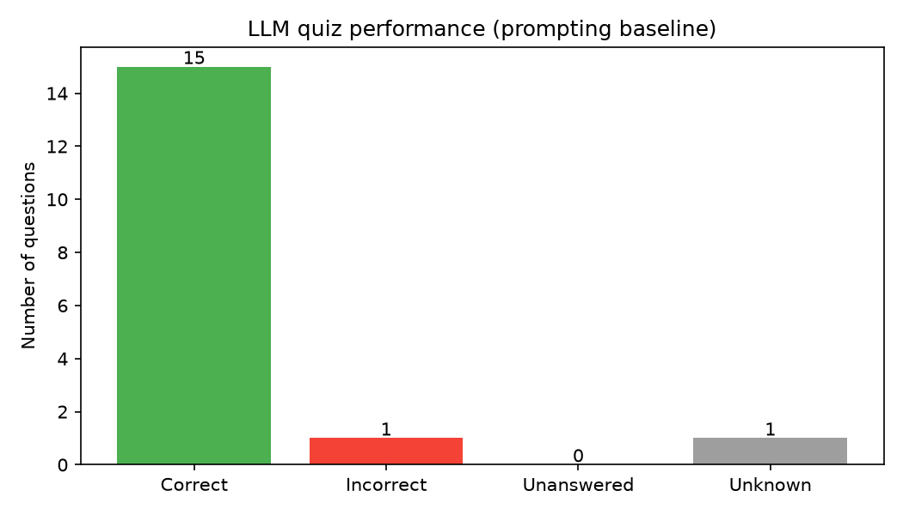

# emasomo-spider

Fetch questions and sources from  quizes and assignments on emasomo , parse them to gemini using gemini api key , gemini process the images and questions and gives only the right answer . If it is multiple choice , gemini responds with eiher A , B , C or D and gives a confidence level ; either high or low . The answers are printed to stdout and are not saved to system . The questions and images sources for both questions and answers are saved to temporary directory which self destructs once it is closed. 

## Benchmark
This is a graph showing the answers that  the gemini got right  through the script vs what moodle (e-masomo) marked as the correct answer.

The "correct answers" are what moodle marked as correct in a quiz done by me . I had a score of **28 / 30** which means , The script assumes 28 correct answers and 2 unknown , so , with that assumption , the model scored 15/15 removing the 2 questions which answers are not known. If we do not make that assumption , the model scored 15/17 which is a whooping 88% on the quiz. 

This is the graph: 




## What it does

`emasomo_spider.py` downloads the questions from a current  quiz attempt on the
[E-masomo](https://emasomo.cuk.ac.ke) Moodle LMS by reading the attempt's
live  page (`/mod/quiz/attempt.php`).

1. **Logs in with your session.** It does not take a username or password.
   It sends the `MoodleSession` cookie set in `COOKIE`, so you must already be
   logged in through a browser.
2. **Walks the review pages.** It requests page 0, 1, 2, … of the attempt
   given in `PARAMS` (`attempt` and `cmid`). It stops when a page has no new
   questions, or after 40 pages. It waits 1.5 s between pages to go easy on the
   server.
3. **Retries failed requests.** If a page does not return HTTP 200, it retries
   after 5, 15, 30 and 60 seconds before giving up. If Moodle redirects to the
   login page, it stops and tells you the session has expired.
4. **Extracts each question**, including:
   - the question text
   - the question type (multichoice, truefalse, shortanswer, match, ddwtos,
     gapselect, numerical or essay)
   - the answer options
   - links to any images in the question or its options

   Moodle's extra elements (question info, flags, response history) are
   removed. If a question is only an image and has no text, it is marked
   `text_missing`.
5. **Saves the results** to the current directory:
   - `questions.json`: all questions as structured data
   - `questions.md`: an easy-to-read version with lettered options and
     embedded images. Set `WRITE_MARKDOWN = False` to skip this file.
6. **Prints a summary table** in the terminal listing each question's
   number, type, a short preview, how many options and images it has, and
   whether its text was found.
7. **answers.py takes the questions and feeds them to gemini through their free api key and gemini answers the questions and gives back answers. Answers are saved in answers.md

### Example `questions.json` entry

```jsong
{
  "number": 1,
  "type": "multichoice",
  "question": "Which of the following ...?",
  "question_images": [],
  "options": [
    { "text": "a. First option", "images": [] },
    { "text": "b. Second option", "images": [] }
  ],
  "text_missing": false
}
```

### Settings

These are set at the top of `emasomo_spider.py`:

| Setting          | Purpose                                                        |
| ---------------- | -------------------------------------------------------------- |
| `COOKIE`         | Your `MoodleSession` cookie value from the browser             |
| `PARAMS`         | The `attempt` and `cmid` from the quiz  page URL          |
| `WRITE_MARKDOWN` | Whether to write `questions.md` as well as `questions.json`    |

To scrape a different quiz, open its review page in the browser and copy the
`attempt` and `cmid` values from the URL into `PARAMS`.

> Only use it on your own account.


## requirements

```python 3.0 > ```

Create virtual environment

```bash
python -m venv .venv

```
Activate virtual environment

```bash
source .venv/bin/activate

```
Install dependencies

```bash
pip install -r requirements.txt

```
## Run

1. Fetch cookie session token from browser

2. Replace session cookie with the current session cookie

```bash
sed -i 's/^COOKIE = .*/COOKIE = "new_value"/' emasomo_spider.py

```
new_value should be the new session token 

3. Run

```bash
python3 emasomo_spider.py

```
